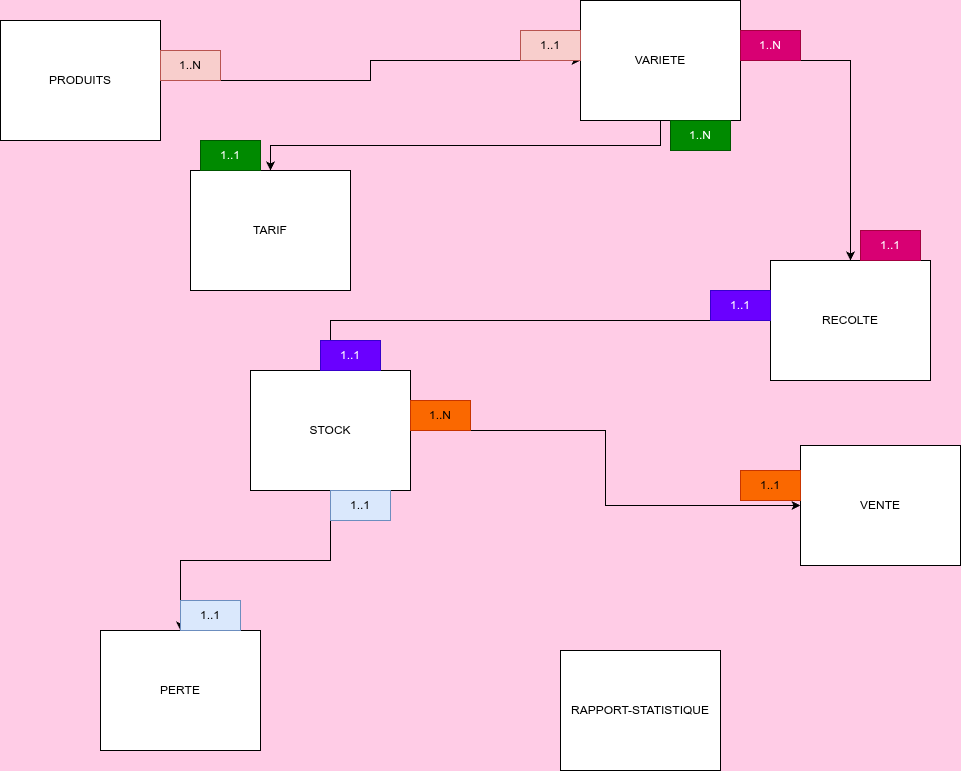

# Gestion Comptable Agricole - Projet BDA L3 GL

## Contexte

Un étudiant-entrepreneur agricole gère une exploitation diversifiée de **10 hectares** cultivant plusieurs produits (oignon, carotte, aubergine, piment, choux, etc.) en différentes variétés. Le système doit permettre le suivi temps réel des récoltes, stocks, ventes, pertes et générer des rapports statistiques automatisés pour optimiser la gestion et réduire les pertes.

---

## 1. Niveau Conceptuel : Diagramme E-A

### Entités principales

- **PRODUITS** : catalogue des produits agricoles
- **VARIETE** : variantes d'un produit
- **TARIF** : prix/kg par variété (variable dans le temps)
- **RECOLTE** : enregistrement journalier des récoltes
- **STOCK** : quantités disponibles actuelles
- **VENTE** : transactions commerciales
- **PERTE** : invendus et produits non-vendables
- **RAPPORT_STATISTIQUE** : agrégations pour rapports

### Cardinalités principales

| Relation | Signification |
|----------|---------------|
| PRODUITS (1,N) VARIETE | Un produit a plusieurs variétés |
| VARIETE (1,N) RECOLTE | Une variété peut être récoltée |
| RECOLTE (1,N) STOCK | Une récolte alimente le stock |
| STOCK (1,N) VENTE | Un stock peut être vendu |
| STOCK (1,N) PERTE | Un stock peut avoir des pertes |

---

## 2. Niveau Logique : Modèle Relationnel

### Schéma relationnel

```text
PRODUITS(id, nom, description, date_creation)
PK: id

VARIETE(id, nom_variete, id_produit, description, date_ajout)
PK: id
FK: id_produit → PRODUITS(id)
UNIQUE(id_produit, nom_variete)

TARIF(id, id_variete, prix_kg, date_debut, date_fin, marche, created_at)
PK: id
FK: id_variete → VARIETE(id)

RECOLTE(id, id_variete, quantite_kg, date_recolte, num_lot, description, created_at)
PK: id
FK: id_variete → VARIETE(id)
UNIQUE(num_lot)

STOCK(id, id_variete, quantite_disponible, derniere_maj)
PK: id
FK: id_variete → VARIETE(id)
UNIQUE(id_variete)

VENTE(id, id_stock, quantite_kg, prix_unitaire, montant_total, date_vente, created_at)
PK: id
FK: id_stock → STOCK(id)

PERTE(id, id_stock, quantite_kg, raison_perte, date_perte, created_at)
PK: id
FK: id_stock → STOCK(id)

RAPPORT_STATISTIQUE(id, periode, id_variete, total_recolte_kg, total_vente_kg,
total_perte_kg, ca_periode, taux_vente_pct, created_at)
PK: id
FK: id_variete → VARIETE(id)
```

### Tableau des entités et attributs

| Entité | Attributs | PK | FK |
|--------|-----------|----|----|
| **PRODUITS** | id, nom, description, date_creation | id | - |
| **VARIETE** | id, nom_variete, id_produit, description, date_ajout | id | id_produit → PRODUITS |
| **TARIF** | id, id_variete, prix_kg, date_debut, date_fin, marche, created_at | id | id_variete → VARIETE |
| **RECOLTE** | id, id_variete, quantite_kg, date_recolte, num_lot, description, created_at | id | id_variete → VARIETE |
| **STOCK** | id, id_variete, quantite_disponible, derniere_maj | id | id_variete → VARIETE |
| **VENTE** | id, id_stock, quantite_kg, prix_unitaire, montant_total, date_vente, created_at | id | id_stock → STOCK |
| **PERTE** | id, id_stock, quantite_kg, raison_perte, date_perte, created_at | id | id_stock → STOCK |
| **RAPPORT_STATISTIQUE** | id, periode, id_variete, total_recolte_kg, total_vente_kg, total_perte_kg, ca_periode, taux_vente_pct, created_at | id | id_variete → VARIETE |

---

## 3. Niveau Physique : Scripts SQL (PostgreSQL)

### 3.1 Création des tables

```sql
CREATE TABLE produits (
    id SERIAL PRIMARY KEY,
    nom VARCHAR(100) NOT NULL UNIQUE,
    description TEXT,
    date_creation TIMESTAMP DEFAULT CURRENT_TIMESTAMP
);

CREATE TABLE variete (
    id SERIAL PRIMARY KEY,
    id_produit INT NOT NULL,
    nom_variete VARCHAR(100) NOT NULL,
    description TEXT,
    date_ajout TIMESTAMP DEFAULT CURRENT_TIMESTAMP,
    FOREIGN KEY (id_produit) REFERENCES produits(id) ON DELETE CASCADE,
    UNIQUE(id_produit, nom_variete)
);

CREATE TABLE tarif (
    id SERIAL PRIMARY KEY,
    id_variete INT NOT NULL,
    prix_kg DECIMAL(10, 2) NOT NULL CHECK (prix_kg >= 0),
    date_debut DATE NOT NULL,
    date_fin DATE,
    marche VARCHAR(100),
    created_at TIMESTAMP DEFAULT CURRENT_TIMESTAMP,
    FOREIGN KEY (id_variete) REFERENCES variete(id) ON DELETE CASCADE
);

CREATE TABLE recolte (
    id SERIAL PRIMARY KEY,
    id_variete INT NOT NULL,
    quantite_kg DECIMAL(10, 2) NOT NULL CHECK (quantite_kg > 0),
    date_recolte DATE NOT NULL,
    num_lot VARCHAR(50) UNIQUE,
    description TEXT,
    created_at TIMESTAMP DEFAULT CURRENT_TIMESTAMP,
    FOREIGN KEY (id_variete) REFERENCES variete(id) ON DELETE CASCADE
);

CREATE TABLE stock (
    id SERIAL PRIMARY KEY,
    id_variete INT NOT NULL UNIQUE,
    quantite_disponible DECIMAL(10, 2) NOT NULL DEFAULT 0 CHECK (quantite_disponible >= 0),
    derniere_maj TIMESTAMP DEFAULT CURRENT_TIMESTAMP,
    FOREIGN KEY (id_variete) REFERENCES variete(id) ON DELETE CASCADE
);

CREATE TABLE vente (
    id SERIAL PRIMARY KEY,
    id_stock INT NOT NULL,
    quantite_kg DECIMAL(10, 2) NOT NULL CHECK (quantite_kg > 0),
    prix_unitaire DECIMAL(10, 2) NOT NULL CHECK (prix_unitaire >= 0),
    montant_total DECIMAL(12, 2) GENERATED ALWAYS AS (quantite_kg * prix_unitaire) STORED,
    date_vente DATE NOT NULL,
    created_at TIMESTAMP DEFAULT CURRENT_TIMESTAMP,
    FOREIGN KEY (id_stock) REFERENCES stock(id) ON DELETE CASCADE
);

CREATE TABLE perte (
    id SERIAL PRIMARY KEY,
    id_stock INT NOT NULL,
    quantite_kg DECIMAL(10, 2) NOT NULL CHECK (quantite_kg > 0),
    raison_perte VARCHAR(200),
    date_perte DATE NOT NULL,
    created_at TIMESTAMP DEFAULT CURRENT_TIMESTAMP,
    FOREIGN KEY (id_stock) REFERENCES stock(id) ON DELETE CASCADE
);

CREATE TABLE rapport_statistique (
    id SERIAL PRIMARY KEY,
    periode VARCHAR(50),
    id_variete INT,
    total_recolte_kg DECIMAL(10, 2),
    total_vente_kg DECIMAL(10, 2),
    total_perte_kg DECIMAL(10, 2),
    ca_periode DECIMAL(12, 2),
    taux_vente_pct DECIMAL(5, 2),
    created_at TIMESTAMP DEFAULT CURRENT_TIMESTAMP,
    FOREIGN KEY (id_variete) REFERENCES variete(id) ON DELETE SET NULL
);
```

### 3.2 Indices pour optimisation

```sql
CREATE INDEX idx_variete_id_produit ON variete(id_produit);
CREATE INDEX idx_recolte_id_variete ON recolte(id_variete);
CREATE INDEX idx_recolte_date ON recolte(date_recolte);
CREATE INDEX idx_stock_id_variete ON stock(id_variete);
CREATE INDEX idx_vente_id_stock ON vente(id_stock);
CREATE INDEX idx_vente_date ON vente(date_vente);
CREATE INDEX idx_perte_id_stock ON perte(id_stock);
CREATE INDEX idx_tarif_id_variete ON tarif(id_variete);
CREATE INDEX idx_rapport_id_variete ON rapport_statistique(id_variete);
```

### 3.3 Triggers pour automatisation

```sql
-- ==================== TRIGGER 1 : VENTE ====================
-- Décrémentation stock après vente
CREATE OR REPLACE FUNCTION decremente_stock_vente()
RETURNS TRIGGER AS $$
BEGIN
    UPDATE stock
    SET quantite_disponible = quantite_disponible - NEW.quantite_kg,
    derniere_maj = CURRENT_TIMESTAMP
    WHERE id = NEW.id_stock;
    RETURN NEW;
END;
$$ LANGUAGE plpgsql;

CREATE TRIGGER tr_vente_stock
AFTER INSERT ON vente
FOR EACH ROW
EXECUTE FUNCTION decremente_stock_vente();


-- ==================== TRIGGER 2 : PERTE ====================
-- Décrémentation stock après perte
CREATE OR REPLACE FUNCTION decremente_stock_perte()
RETURNS TRIGGER AS $$
BEGIN
    UPDATE stock
    SET quantite_disponible = quantite_disponible - NEW.quantite_kg,
    derniere_maj = CURRENT_TIMESTAMP
    WHERE id = NEW.id_stock;
    RETURN NEW;
END;
$$ LANGUAGE plpgsql;

CREATE TRIGGER tr_perte_stock
AFTER INSERT ON perte
FOR EACH ROW
EXECUTE FUNCTION decremente_stock_perte();


-- ==================== TRIGGER 3 : RECOLTE ====================
-- Augmentation stock après récolte
CREATE OR REPLACE FUNCTION alimente_stock_recolte()
RETURNS TRIGGER AS $$
BEGIN
    UPDATE stock
    SET quantite_disponible = quantite_disponible + NEW.quantite_kg,
    derniere_maj = CURRENT_TIMESTAMP
    WHERE id_variete = NEW.id_variete;
    RETURN NEW;
END;
$$ LANGUAGE plpgsql;

CREATE TRIGGER tr_recolte_stock
AFTER INSERT ON recolte
FOR EACH ROW
EXECUTE FUNCTION alimente_stock_recolte();
```
