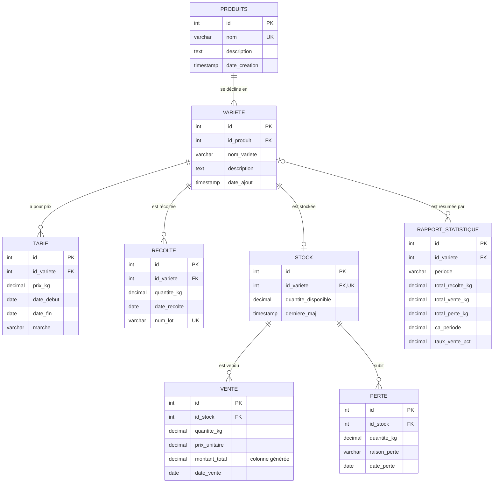

# Gestion Comptable Agricole - Projet BDA L3 GL

## Contexte

Un étudiant-entrepreneur agricole gère une exploitation diversifiée de **10 hectares** cultivant plusieurs produits (oignon, carotte, aubergine, piment, choux, etc.) en différentes variétés. Le système doit permettre le suivi temps réel des récoltes, stocks, ventes, pertes et générer des rapports statistiques automatisés pour optimiser la gestion et réduire les pertes.

---

## 1. Niveau Conceptuel : Diagramme E-A


### Entités principales

- **PRODUITS** : catalogue des produits agricoles
- **VARIETE** : variantes d'un produit
- **TARIF** : prix/kg par variété (variable dans le temps)
- **RECOLTE** : enregistrement journalier des récoltes
- **STOCK** : quantités disponibles actuelles
- **VENTE** : transactions commerciales
- **PERTE** : invendus et produits non-vendables
- **RAPPORT_STATISTIQUE** : agrégations pour rapports

### Cardinalités principales

| Relation | Cardinalités | Signification |
|----------|--------------|---------------|
| PRODUITS — VARIETE | (1,N) — (1,1) | Un produit a une ou plusieurs variétés ; une variété appartient à un seul produit |
| VARIETE — TARIF | (0,N) — (1,1) | Le prix d'une variété change dans le temps ; chaque tarif concerne une seule variété |
| VARIETE — RECOLTE | (0,N) — (1,1) | Une variété est récoltée plusieurs fois ; chaque récolte concerne une seule variété |
| VARIETE — STOCK | (0,1) — (1,1) | Une variété a au plus un stock, créé à sa première récolte |
| STOCK — VENTE | (0,N) — (1,1) | Un stock est vendu en plusieurs fois ; chaque vente puise dans un seul stock |
| STOCK — PERTE | (0,N) — (1,1) | Un stock peut subir plusieurs pertes ; chaque perte concerne un seul stock |
| VARIETE — RAPPORT_STATISTIQUE | (0,N) — (0,1) | Un rapport porte sur une variété, ou sur toute l'exploitation si la variété est vide |

----------|---------------|
| PRODUITS (1,N) VARIETE | Un produit a plusieurs variétés |
| VARIETE (1,N) RECOLTE | Une variété peut être récoltée |
| RECOLTE (1,N) STOCK | Une récolte alimente le stock |
| STOCK (1,N) VENTE | Un stock peut être vendu |
| STOCK (1,N) PERTE | Un stock peut avoir des pertes |

---

## 2. Niveau Logique : Modèle Relationnel

### Schéma relationnel

```text
PRODUITS(id, nom, description, date_creation)
PK: id

VARIETE(id, nom_variete, id_produit, description, date_ajout)
PK: id
FK: id_produit → PRODUITS(id)
UNIQUE(id_produit, nom_variete)

TARIF(id, id_variete, prix_kg, date_debut, date_fin, marche, created_at)
PK: id
FK: id_variete → VARIETE(id)

RECOLTE(id, id_variete, quantite_kg, date_recolte, num_lot, description, created_at)
PK: id
FK: id_variete → VARIETE(id)
UNIQUE(num_lot)

STOCK(id, id_variete, quantite_disponible, derniere_maj)
PK: id
FK: id_variete → VARIETE(id)
UNIQUE(id_variete)

VENTE(id, id_stock, quantite_kg, prix_unitaire, montant_total, date_vente, created_at)
PK: id
FK: id_stock → STOCK(id)

PERTE(id, id_stock, quantite_kg, raison_perte, date_perte, created_at)
PK: id
FK: id_stock → STOCK(id)

RAPPORT_STATISTIQUE(id, periode, id_variete, total_recolte_kg, total_vente_kg,
total_perte_kg, ca_periode, taux_vente_pct, created_at)
PK: id
FK: id_variete → VARIETE(id)
```

### Tableau des entités et attributs

| Entité | Attributs | PK | FK |
|--------|-----------|----|----|
| **PRODUITS** | id, nom, description, date_creation | id | - |
| **VARIETE** | id, nom_variete, id_produit, description, date_ajout | id | id_produit → PRODUITS |
| **TARIF** | id, id_variete, prix_kg, date_debut, date_fin, marche, created_at | id | id_variete → VARIETE |
| **RECOLTE** | id, id_variete, quantite_kg, date_recolte, num_lot, description, created_at | id | id_variete → VARIETE |
| **STOCK** | id, id_variete, quantite_disponible, derniere_maj | id | id_variete → VARIETE |
| **VENTE** | id, id_stock, quantite_kg, prix_unitaire, montant_total, date_vente, created_at | id | id_stock → STOCK |
| **PERTE** | id, id_stock, quantite_kg, raison_perte, date_perte, created_at | id | id_stock → STOCK |
| **RAPPORT_STATISTIQUE** | id, periode, id_variete, total_recolte_kg, total_vente_kg, total_perte_kg, ca_periode, taux_vente_pct, created_at | id | id_variete → VARIETE |

---

## 3. Niveau Physique : Scripts SQL (PostgreSQL)

Les scripts ci-dessous sont aussi rassemblés dans [`../database/schema.sql`](../database/schema.sql), prêt à exécuter : `psql -d ma_base -f database/schema.sql`.

### 3.1 Création des tables

Les récoltes, ventes, pertes et tarifs forment l'historique comptable : leurs clés étrangères sont en `ON DELETE RESTRICT`, pour qu'une suppression de stock ou de variété ne puisse jamais effacer cet historique.

```sql
CREATE TABLE produits (
    id SERIAL PRIMARY KEY,
    nom VARCHAR(100) NOT NULL UNIQUE,
    description TEXT,
    date_creation TIMESTAMP DEFAULT CURRENT_TIMESTAMP
);

CREATE TABLE variete (
    id SERIAL PRIMARY KEY,
    id_produit INT NOT NULL,
    nom_variete VARCHAR(100) NOT NULL,
    description TEXT,
    date_ajout TIMESTAMP DEFAULT CURRENT_TIMESTAMP,
    FOREIGN KEY (id_produit) REFERENCES produits(id) ON DELETE CASCADE,
    UNIQUE(id_produit, nom_variete)
);

CREATE TABLE tarif (
    id SERIAL PRIMARY KEY,
    id_variete INT NOT NULL,
    prix_kg DECIMAL(10, 2) NOT NULL CHECK (prix_kg >= 0),
    date_debut DATE NOT NULL,
    date_fin DATE,
    marche VARCHAR(100),
    created_at TIMESTAMP DEFAULT CURRENT_TIMESTAMP,
    FOREIGN KEY (id_variete) REFERENCES variete(id) ON DELETE RESTRICT,
    CHECK (date_fin IS NULL OR date_fin >= date_debut)
);

CREATE TABLE recolte (
    id SERIAL PRIMARY KEY,
    id_variete INT NOT NULL,
    quantite_kg DECIMAL(10, 2) NOT NULL CHECK (quantite_kg > 0),
    date_recolte DATE NOT NULL,
    num_lot VARCHAR(50) UNIQUE,
    description TEXT,
    created_at TIMESTAMP DEFAULT CURRENT_TIMESTAMP,
    FOREIGN KEY (id_variete) REFERENCES variete(id) ON DELETE RESTRICT
);

CREATE TABLE stock (
    id SERIAL PRIMARY KEY,
    id_variete INT NOT NULL UNIQUE,
    quantite_disponible DECIMAL(10, 2) NOT NULL DEFAULT 0 CHECK (quantite_disponible >= 0),
    derniere_maj TIMESTAMP DEFAULT CURRENT_TIMESTAMP,
    FOREIGN KEY (id_variete) REFERENCES variete(id) ON DELETE CASCADE
);

CREATE TABLE vente (
    id SERIAL PRIMARY KEY,
    id_stock INT NOT NULL,
    quantite_kg DECIMAL(10, 2) NOT NULL CHECK (quantite_kg > 0),
    prix_unitaire DECIMAL(10, 2) NOT NULL CHECK (prix_unitaire >= 0),
    montant_total DECIMAL(12, 2) GENERATED ALWAYS AS (quantite_kg * prix_unitaire) STORED,
    date_vente DATE NOT NULL,
    created_at TIMESTAMP DEFAULT CURRENT_TIMESTAMP,
    FOREIGN KEY (id_stock) REFERENCES stock(id) ON DELETE RESTRICT
);

CREATE TABLE perte (
    id SERIAL PRIMARY KEY,
    id_stock INT NOT NULL,
    quantite_kg DECIMAL(10, 2) NOT NULL CHECK (quantite_kg > 0),
    raison_perte VARCHAR(200),
    date_perte DATE NOT NULL,
    created_at TIMESTAMP DEFAULT CURRENT_TIMESTAMP,
    FOREIGN KEY (id_stock) REFERENCES stock(id) ON DELETE RESTRICT
);

CREATE TABLE rapport_statistique (
    id SERIAL PRIMARY KEY,
    periode VARCHAR(50),
    id_variete INT,
    total_recolte_kg DECIMAL(10, 2),
    total_vente_kg DECIMAL(10, 2),
    total_perte_kg DECIMAL(10, 2),
    ca_periode DECIMAL(12, 2),
    taux_vente_pct DECIMAL(5, 2),
    created_at TIMESTAMP DEFAULT CURRENT_TIMESTAMP,
    FOREIGN KEY (id_variete) REFERENCES variete(id) ON DELETE SET NULL
);
```

### 3.2 Indices pour optimisation

Les contraintes `UNIQUE(id_produit, nom_variete)` sur `variete` et `UNIQUE(id_variete)` sur `stock` créent déjà un index : il n'est pas utile d'en ajouter un sur ces colonnes.

```sql
CREATE INDEX idx_recolte_id_variete ON recolte(id_variete);
CREATE INDEX idx_recolte_date ON recolte(date_recolte);
CREATE INDEX idx_vente_id_stock ON vente(id_stock);
CREATE INDEX idx_vente_date ON vente(date_vente);
CREATE INDEX idx_perte_id_stock ON perte(id_stock);
CREATE INDEX idx_tarif_id_variete ON tarif(id_variete);
CREATE INDEX idx_rapport_id_variete ON rapport_statistique(id_variete);
```

### 3.3 Triggers pour automatisation

Le stock se tient à jour tout seul. Une récolte l'augmente, une vente ou une perte le diminue. Si une écriture est modifiée ou supprimée, son effet est d'abord annulé, puis la nouvelle valeur est appliquée. Comme le stock ne peut pas être négatif, toute opération qui ferait vendre plus que ce qui reste est refusée, et PostgreSQL annule l'opération entière.

```sql
-- ==================== SORTIES : VENTE ET PERTE ====================
-- Une vente et une perte retirent toutes deux une quantité du stock
CREATE OR REPLACE FUNCTION maj_stock_sortie()
RETURNS TRIGGER AS $$
BEGIN
    -- Modification ou suppression : on rend d'abord l'ancienne quantité
    IF TG_OP IN ('UPDATE', 'DELETE') THEN
        UPDATE stock
        SET quantite_disponible = quantite_disponible + OLD.quantite_kg,
            derniere_maj = CURRENT_TIMESTAMP
        WHERE id = OLD.id_stock;
    END IF;
    -- Ajout ou modification : on retire la nouvelle quantité
    IF TG_OP IN ('INSERT', 'UPDATE') THEN
        UPDATE stock
        SET quantite_disponible = quantite_disponible - NEW.quantite_kg,
            derniere_maj = CURRENT_TIMESTAMP
        WHERE id = NEW.id_stock;
    END IF;
    RETURN NULL;
END;
$$ LANGUAGE plpgsql;

CREATE TRIGGER tr_vente_stock
AFTER INSERT OR UPDATE OR DELETE ON vente
FOR EACH ROW
EXECUTE FUNCTION maj_stock_sortie();

CREATE TRIGGER tr_perte_stock
AFTER INSERT OR UPDATE OR DELETE ON perte
FOR EACH ROW
EXECUTE FUNCTION maj_stock_sortie();


-- ==================== ENTRÉES : RÉCOLTE ====================
-- Une récolte ajoute au stock de sa variété, et crée ce stock à la première récolte
CREATE OR REPLACE FUNCTION maj_stock_recolte()
RETURNS TRIGGER AS $$
BEGIN
    -- Quantité corrigée sur la même variété : on applique seulement la différence,
    -- pour ne pas faire passer le stock sous zéro entre les deux étapes
    IF TG_OP = 'UPDATE' AND OLD.id_variete = NEW.id_variete THEN
        UPDATE stock
        SET quantite_disponible = quantite_disponible + NEW.quantite_kg - OLD.quantite_kg,
            derniere_maj = CURRENT_TIMESTAMP
        WHERE id_variete = NEW.id_variete;
        RETURN NULL;
    END IF;
    -- Suppression, ou changement de variété : on retire l'ancienne quantité
    IF TG_OP IN ('UPDATE', 'DELETE') THEN
        UPDATE stock
        SET quantite_disponible = quantite_disponible - OLD.quantite_kg,
            derniere_maj = CURRENT_TIMESTAMP
        WHERE id_variete = OLD.id_variete;
    END IF;
    -- Ajout, ou changement de variété : on ajoute la nouvelle quantité
    IF TG_OP IN ('INSERT', 'UPDATE') THEN
        INSERT INTO stock (id_variete, quantite_disponible, derniere_maj)
        VALUES (NEW.id_variete, NEW.quantite_kg, CURRENT_TIMESTAMP)
        ON CONFLICT (id_variete) DO UPDATE
        SET quantite_disponible = stock.quantite_disponible + EXCLUDED.quantite_disponible,
            derniere_maj = CURRENT_TIMESTAMP;
    END IF;
    RETURN NULL;
END;
$$ LANGUAGE plpgsql;

CREATE TRIGGER tr_recolte_stock
AFTER INSERT OR UPDATE OR DELETE ON recolte
FOR EACH ROW
EXECUTE FUNCTION maj_stock_recolte();
```
